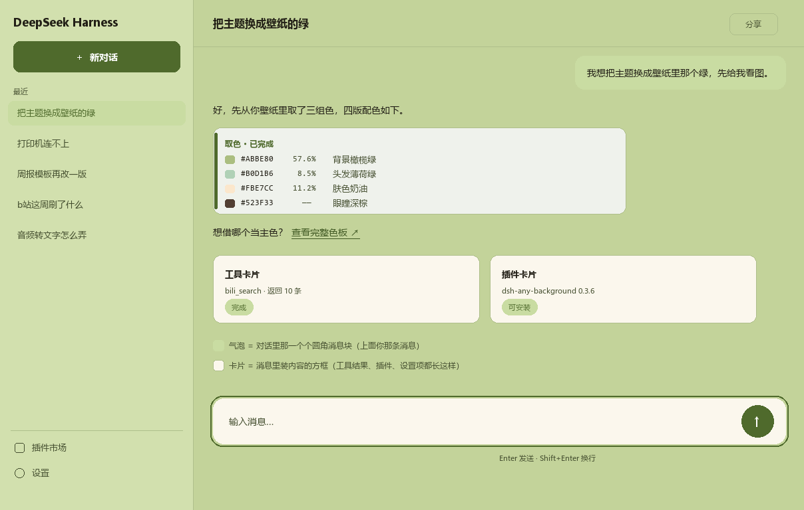

# 绿野 · dsh-greenwild

一套从桌面壁纸取色的 DSH（DeepSeek Harness）浅色皮肤：**橄榄绿主色 + 奶油绿底 + 纸色卡面**，整窗生效，设置里一个开关，关掉立刻还原原来的深色。



## 它长什么样

| 位置 | 颜色 |
| --- | --- |
| 画布（整窗底） | `#C3D39A` |
| 左侧栏 | `#D2E0AE` |
| 工作区小卡 | `#E2EBC8` |
| 纸色（回话卡片 / 输入框 / 菜单 / 按钮） | `#FBF7ED` |
| 主色（按钮、选中、焦点） | `#4F6A2C` |
| 主文字 / 次文字 / 说明字 | `#221F16` / `#434D2E` / `#4E5738` |
| 代码块 | `#EFF2EC`（左侧一条主色竖条） |

配色来自一张桌面壁纸（橄榄绿背景、薄荷发色、奶油肤色），不是随手挑的。

## 安装

DSH 目前没有插件安装命令行，手动三步就能装：

**1. 把仓库放进来**

```bash
git clone https://github.com/AbsolutorLiu/dsh-greenwild.git ~/.dsh/plugins/dsh-greenwild
```

**2. 在 profile 里登记**

打开 `~/.dsh/profiles/<你的 profile>/package.json`（桌面版通常是 `desktop`），做两处修改：

```jsonc
{
  "dependencies": {
    "dsh-greenwild": "file:../../plugins/dsh-greenwild"   // 加这一行
  },
  "dsh": {
    "profile": {
      "bundles": ["...", "dsh-greenwild"]                  // 数组末尾加这一项
    }
  }
}
```

**3. 完整退出 DSH 再打开**（托盘右键退出，不是 `Ctrl+R`）

打开后：**设置 → 插件 → 绿野**，那一行右边的开关就是它。

## 开关怎么用

- **开**：整窗换成上面的浅色，同时把内置「外观」切到浅色，两者对得上，不会出现“界面是浅的、设置里写着深色”。
- **关**：立刻回到你原来的深色，不留残余；内置「外观」也会还原成你开之前的设置。

开关状态记在浏览器本地（`localStorage`），重启后保持。

## 实现方式

- 主路径是 DSH 的主题服务：`ctx.theme.overrideTokens('dsh-greenwild', {...})`，一共覆盖 **113 个** `--dsw-alias-*` / `--dsw-specific-*` 设计令牌；每个令牌同时给出 light / dark 两个值（值相同），这样即使某处按深色主题取值，也不会突然冒出一块黑。
- 少数几个位置的颜色在 DSH 里是写死的（会话悬停浮窗、回话卡片、左侧“工作区”行、左上「新会话」按钮、右侧面板），令牌改不到，用定点 CSS 覆盖。这些选择器依赖 DSH 当前的内部类名。

**不联网、不写文件、不改任何数据**，只改 CSS 变量和几条样式规则。

## 已知限制

- 只做浅色一套。深色模式下不生效（本皮肤的设计取向就是“浅色 + 绿”）。
- 定点 CSS 依赖 DSH 内部类名（形如 `xMeOpW_root`、`wnFoaW_projectRow`、`acoR2W_*`）。DSH 升级后如果发现“某一块没变色”，基本就是类名改了，改选择器即可。
- 跟随系统的深色/浅色切换不影响本皮肤：它由自己的开关控制。

## 卸载

从 profile 的 `bundles` 里删掉 `dsh-greenwild`、删掉依赖、删掉 `~/.dsh/plugins/dsh-greenwild`，重启即可。（建议先关掉开关再卸。）

## License

MIT
